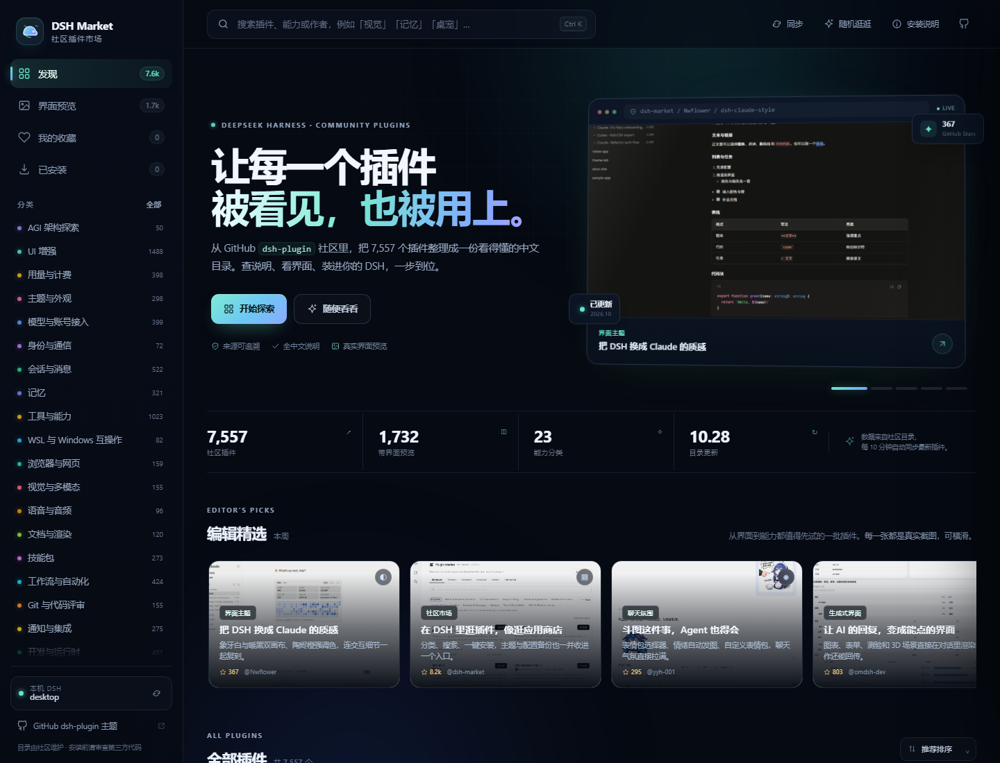
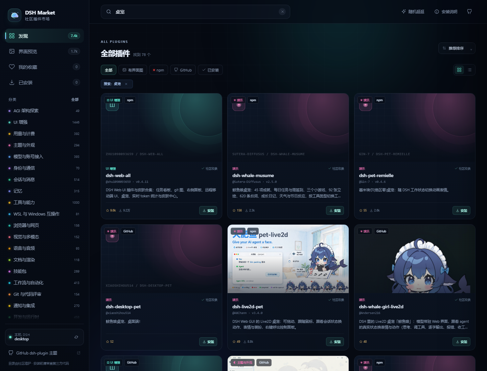
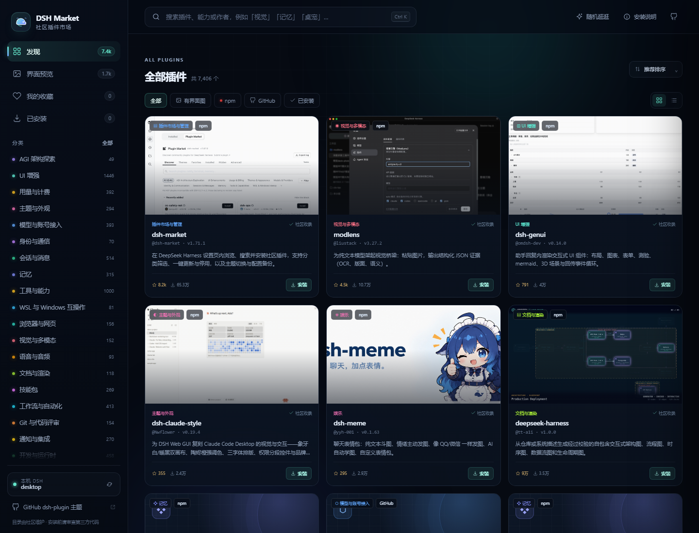
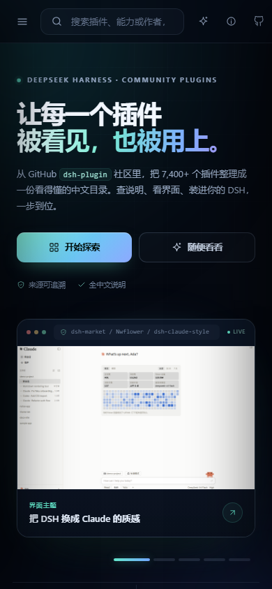
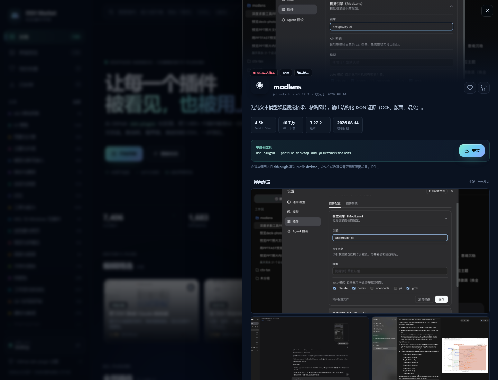

# DSH Local Market · 中文插件市场

一个给 **DeepSeek Harness** 用的中文插件市场：从 GitHub [`dsh-plugin`](https://github.com/topics/dsh-plugin) 社区目录读取插件，支持中文检索、分类筛选、界面截图和一键安装。

它可以作为 **DSH 插件**直接打开，也可以作为独立网页运行。



## 功能

- **实时目录**：运行时从 [awesome-dsh-plugin](https://awesome-dsh-plugin.com) 拉取最新目录，每 10 分钟自动同步；顶栏「同步」按钮可手动刷新
- **中文检索**：按插件名、作者、中文说明、分类和能力搜索，支持中英文关键词
- **分类筛选**：23 个能力分类，支持「有界面图 / npm / GitHub / 已安装」快速筛选与排序
- **界面预览**：展示作者提供的真实截图；没有截图的插件使用分类插画封面，详情页支持多图放大
- **一键安装**：调用本机 `dsh plugin --profile <profile> add <spec>`，实时显示 pnpm 日志
- **安装前检查**：作者、仓库、npm 包、版本、权限声明、第三方代码提示
- **已安装状态**：读取当前 DSH profile 的真实依赖与组合包；在 DSH 里从别处安装的插件，也会在约 5 秒内同步到「已安装」
- **响应式**：桌面、平板、手机均可使用



## 作为 DSH 插件安装

### 从 GitHub 安装

```powershell
dsh plugin --profile <profile> add github:YML0823/dsh-local-market
```

把 `<profile>` 换成你的 DSH profile（例如 `web` 或 `desktop`）。

安装后重启一次 DSH（或按 DSH 的提示重载），打开左侧 **插件**，顶部会出现 **「中文市场」** Tab：

```text
已安装   中文市场   插件市场   发现
```

点击 **中文市场** 即可使用。在 **已安装** 列表里也能看到 `dsh-local-market` 本体并启停。

> 如果你同时装了社区市场 `dshmarket`，它的 Tab 叫「插件市场」；本项目特意叫「中文市场」，避免两个同名入口混淆。

### 从本地 tarball 安装

```powershell
dsh plugin --profile web add "file:F:/path/to/dsh-local-market-1.0.2.tgz"
```

已发布版本可直接下载：[GitHub Releases · v1.0.2](https://github.com/YML0823/dsh-local-market/releases/tag/v1.0.2)

构建 tarball：

```bash
node scripts/build-plugin.js
```

产物输出到 `dist/dsh-local-market-1.0.2.tgz`。

### 插件结构

1. **Host 插件** `plugin/index.js`：在 DSH 的 webServer 上挂载 `/dsh-local-market/`，提供静态页面、实时目录 API、截图代理和安装 API
2. **Client 插件** `plugin/client.js`：向 `plugins.tab` 注册「中文市场」Tab，用 iframe 打开市场页面

插件运行时会自己读取当前机器的 `DSH_HOME`、profile 和 `dsh` CLI，不包含作者机器上的路径或账号信息。

## 独立网页版

需要 **Node.js 20+**，无需安装 npm 依赖。

```powershell
cd dsh-plugin-market
node server.js
```

打开：

```text
http://127.0.0.1:7788
```

Windows 也可以双击 [`start.cmd`](start.cmd)。

独立版和 DSH 插件版使用同一套 UI、目录和安装 API，区别只是入口不同。

## 实时目录

页面加载时，Host 会请求：

```text
https://awesome-dsh-plugin.com/plugins.json
```

将上游目录规范化后返回给前端；成功同步后统计数字和「目录更新」日期会自动变化。

- 缓存 10 分钟，避免每次打开都重新下载
- 顶栏 **同步** 按钮可强制刷新
- 网络不可用时自动回退到仓库内的快照 `public/data/plugins.json`
- 上游目录包含插件中文说明、截图、安装参数、Star 和下载量

如果上游域名不可访问，可以在启动独立版时设置镜像：

```powershell
$env:CATALOG_LIVE_URL="https://your-mirror.example/plugins.json"
node server.js
```

DSH 插件版会使用代码中的默认上游地址；需要镜像时可修改 `plugin/index.js` 里的 `LIVE_URL`。

## 安装是怎么工作的

市场本身不托管插件。条目里的安装参数来自社区目录，例如：

```text
dsh plugin --profile web add dsh-meme
dsh plugin --profile web add github:owner/repo
dsh plugin --profile web add "https://github.com/.../release.tgz"
```

点击安装后，Host 会：

1. 按条目 id 在**当前目录**中查出精确的安装 spec，不接受任意用户输入；
2. 校验 profile 名称和 spec 格式；
3. 以当前用户权限运行本机 `dsh` CLI；
4. 通过 SSE 把 stdout/stderr 实时推回页面；
5. 成功后把条目记入「已安装」。

### Desktop 用户注意

DSH Desktop 的 `desktop` profile 由桌面应用管理。命令行安装可能被拒绝，或者安装后不出现。遇到这种情况：

- 优先使用 DSH 的 **设置 → 插件** 安装；
- 或把 profile 选为 `web`，供 `dsh web` / 命令行版使用。

安装完成后通常需要刷新页面，部分插件需要重启 DSH。

## 开发

```bash
# 生成离线快照（从目录源）
node scripts/build-data.js

# 构建 DSH 插件 tarball
node scripts/build-plugin.js

# 启动独立版
node server.js
```

`scripts/build-data.js` 默认读取 `vendor/plugins.json`，也可通过 `CATALOG_SOURCE` 指定其他路径。运行时不需要重新生成快照，Host 会自动拉取最新目录。

## 目录结构

```text
.
├─ plugin/                    # DSH 插件源码
│  ├─ index.js                # Host：HTTP 路由、实时目录、安装 API
│  ├─ client.js               # Client：plugins.tab 注册
│  ├─ ui/                     # 随插件分发的市场页面
│  └─ lib/catalog.cjs        # 目录规范化（构建时复制）
├─ lib/catalog.js             # 共享目录规范化模块
├─ server.js                  # 独立版服务
├─ public/                    # 独立版页面与快照
├─ scripts/
│  ├─ build-data.js
│  └─ build-plugin.js
├─ start.cmd
└─ dist/                      # 构建产物（不提交）
```

## 安全与隐私

- 插件是**第三方代码**，会以你的本机权限运行；市场只做索引和调用，不做安全审计。
- 安装前请打开 GitHub 仓库确认作者、来源和权限声明。
- 安装接口只接受目录中存在的条目，spec 与 profile 都会校验；独立版默认只监听 `127.0.0.1`。
- 项目源码不包含作者主机的绝对路径、账号、profile 目录或凭据；运行时信息由用户自己的 DSH 环境提供。
- 截图通过本地 `/api/image` 代理获取并按 URL 缓存，浏览器不会直接访问截图主机。

## 数据与致谢

- 插件主题：[github.com/topics/dsh-plugin](https://github.com/topics/dsh-plugin)
- 社区目录：[awesome-dsh-plugin.com](https://awesome-dsh-plugin.com)
- 运行宿主：[DeepSeek Harness](https://github.com/deepseek-ai/deepseek-harness)

本项目是独立的社区目录界面，不是 DeepSeek 官方商店。







